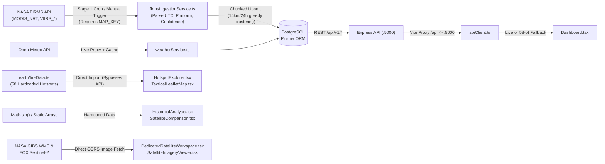

# FireSync — Complete Current Project Audit (Member 2 Baseline)

**Project**: FireSync — Global Wildfire Intelligence & Satellite Observation Platform  
**Challenge**: NASA Space Apps Challenge 2026 — *Harmonization of MODIS and VIIRS Hot Spots*  
**Audit Mode**: Strictly Read-Only Inspection (Zero source files modified; zero dependencies installed; zero database/environment mutations)

---

## 1. Executive Summary & Architectural Verdict

This repository is a full-stack **TypeScript / React / Express / Prisma / PostgreSQL** web application featuring a polished space-themed frontend (3D Three.js Earth globe, 2D Leaflet maps, Recharts analytics, Framer Motion transitions, and live NASA GIBS WMS multi-spectral imagery) backed by an Express REST API and Prisma ORM.

### Alignment with NASA Space Apps 2026 (*Harmonization of MODIS and VIIRS Hot Spots*)
- **Stage 1 Data Ingestion (`firmsIngestionService.ts`)** has recently been upgraded to fetch real NASA FIRMS CSVs (defaulting to India: `IND` / `68.0,6.5,97.5,37.5`), parse true UTC `acq_date` + `acq_time` timestamps, identify spacecraft (`Terra`, `Aqua`, `Suomi-NPP`, `NOAA-20`, `NOAA-21`), preserve VIIRS categorical vs MODIS numeric confidence without fabricating scores, and deduplicate observations via deterministic `sourceId` upserts.
- **Core Harmonization Algorithm**: **NOT IMPLEMENTED.** There is currently **no** common spatial grid assignment, **no** spatiotemporal candidate matching between MODIS and VIIRS overpasses, **no** `MODIS_ONLY` / `VIIRS_ONLY` / `CANDIDATE_MATCH` classification, **no** daily common-grid burning activity aggregation, and **no** statistical unusual-activity detection.
- **Frontend–Backend Disconnection**: While `Dashboard.tsx` attempts live `apiClient.getFires()` calls (falling back to 58 static hotspots in `fireData.ts` if offline), `HotspotExplorer.tsx`, `TacticalLeafletMap.tsx`, `GlobalWildfireDashboard.tsx`, `HistoricalAnalysis.tsx`, and `SatelliteComparison.tsx` rely on hardcoded static arrays or synthetic `Math.sin()` / `Math.random()` data.
- **Live Runtime Prerequisite Status**: Local PostgreSQL (`127.0.0.1:5432`) is currently offline (`P1001`) and `NASA_FIRMS_MAP_KEY` in `backend/.env` is empty, so live DB persistence and live FIRMS ingestion have not yet been executed end-to-end.

---

## 2. Technology Stack & Architecture Diagram

### Technology Stack
| Layer | Technologies & Versions (from `package.json`) |
| :--- | :--- |
| **Frontend Core** | React `18.3.1`, TypeScript `5.6.3`, Vite `5.4.10`, React Router DOM `6.27.0` |
| **Frontend Styling & Motion** | Tailwind CSS `3.4.14`, `tailwind-merge` `2.5.4`, `clsx` `2.1.1`, Framer Motion `11.11.10`, Lucide React `0.454.0` |
| **3D & 2D Visualization** | Three.js `0.169.0`, `@react-three/fiber` `8.17.10`, `@react-three/drei` `9.114.0`, Leaflet `1.9.4`, `react-leaflet` `4.2.1`, Recharts `2.13.0` |
| **Backend Runtime & API** | Node.js, Express `4.21.2`, TypeScript `5.7.2`, Zod `3.24.1`, Helmet `8.0.0`, CORS `2.8.5`, Swagger UI Express `5.0.1`, Winston `3.17.0`, `node-cron` `3.0.3`, Axios `1.7.9` |
| **Database & Auth** | PostgreSQL (Prisma `5.22.0`, `@prisma/client` `5.22.0`, `pg` `8.13.1`), `bcryptjs` `2.4.3`, `jsonwebtoken` `9.0.2` |
| **Root Orchestration** | `concurrently` `9.1.2`, Windows batch launchers (`start-all.bat`, `start-backend.bat`, `start-frontend.bat`) |
| **Python Services** | **None.** Root `.env` contains unused `FASTAPI_*` placeholders, but no Python backend exists in the codebase. |

### System Architecture & Current Data Flow

---

## 3. Complete Feature Inventory

| Feature | Exact File Paths & Key Functions | Purpose & User Functionality | Actual Implementation & Data Flow | Backend/DB Dependencies | Data Source Type | Status | Scientific Correctness & Limitations | Recommendation |
| :--- | :--- | :--- | :--- | :--- | :--- | :--- | :--- | :--- |
| **3D Landing Experience** | `frontend/src/pages/LandingPage/LandingPage.tsx`, `components/earth/EarthScene.tsx`, `EarthGlobe.tsx`, `AtmosphereGlow.tsx`, `Starfield.tsx`, `satellites/SatelliteOrbit.tsx`, `SatelliteInfoCard.tsx` | Cinematic 3D Earth globe with scroll-choreographed sections, orbiting satellites, and clickable satellite cards. | Renders textured Three.js globe, `latLonToVector3` hotspot markers, and orbital splines. | None (pure frontend). | Static (`GLOBAL_HOTSPOTS` 58 points, `SATELLITE_DATA`). | **COMPLETE** | Visual showcase; does not claim harmonization. Keep intact as entry experience. | **KEEP** |
| **Main Dashboard** | `frontend/src/pages/Dashboard/Dashboard.tsx`, `services/fireIntelligenceService.ts`, `components/dashboard/DashboardGlobalMap.tsx` | Global KPIs, diurnal curve, regional risk bar chart, sensor pie chart, searchable/sortable observation table, and 2D map. | Fetches `apiClient.getFires({ limit: 1000 })` on mount/refresh; computes KPIs client-side via `getGlobalMetrics()`, `getDiurnalTimeline()`, `getRegionalIntelligence()`. | `GET /api/v1/fires` (`fire_observations` table). | Live API if online, else silent fallback to 58 static points in `fireData.ts`. | **PARTIALLY COMPLETE** | Diurnal curve and trend percentages in `fireService.ts` (`getDiurnalTrends` uses `Math.sin()`, `previousCycle` uses `* 0.94`) are synthetic; frontend table filter `h.confidence < tableConfidenceFilter` assumes numeric confidence (needs update for VIIRS `null` numeric confidence). | **IMPROVE & INTEGRATE** |
| **Interactive Hotspot Map** | `frontend/src/pages/HotspotExplorer/HotspotExplorer.tsx`, `components/dashboard/TacticalLeafletMap.tsx` | Fullscreen 2D Leaflet map with satellite, confidence, FRP, and region filters + marker inspection sidebar. | Imports `GLOBAL_HOTSPOTS` directly from `earth/fireData.ts`; filters array in `useMemo()`. | **None** (disconnected from `apiClient`). | Static hardcoded 58-point array (`REALISTIC_HOTSPOTS`). | **PARTIALLY COMPLETE** | Completely disconnected from PostgreSQL/FIRMS live data; uses hardcoded `getHotspotMetadata()` defaults (`2024-08-18`, `brightnessTemp` formula). | **INTEGRATE & IMPROVE** |
| **NASA GIBS Satellite Imagery** | `frontend/src/services/satelliteImageryService.ts` (`buildGibsWmsUrl`, `buildHighResSurfaceUrl`), `components/dashboard/DedicatedSatelliteWorkspace.tsx`, `SatelliteImageryViewer.tsx` | Split-screen before/after imagery inspector with True Color, SWIR False Color, Thermal Anomaly layers, zoom/pan, and image download. | Builds live CORS-enabled NASA GIBS WMS 1.3.0 `GetMap` URLs (`gibs.earthdata.nasa.gov`) + EOX Sentinel-2 cloudless surface fallback. | None (direct browser requests to NASA GIBS / EOX). | Real NASA GIBS satellite raster imagery. | **COMPLETE** | Genuine NASA GIBS integration; note `getHotspotMetadata()` supplies default dates if hotspot lacks `acquiredDate`. | **KEEP** |
| **MODIS vs VIIRS Comparison** | `frontend/src/pages/SatelliteComparison/SatelliteComparison.tsx`, `components/satellites/SatelliteViewer3D.tsx`, `backend/src/controllers/dashboardController.ts` (`getSensorComparison`) | 4 tabs: 3D satellite viewer, specifications matrix, interactive 1 km vs 375 m pixel footprint simulator, and biome detection chart. | Tab 0 uses Three.js; Tab 1 renders static `comparisonSpecs`; Tab 2 uses CSS 3×3 grid slider; Tab 3 plots hardcoded `detectionComparisonData`. Backend `/sensor-comparison` exists but is unused by this page. | None in frontend (backend `/api/v1/dashboard/sensor-comparison` unused). | Static / hardcoded benchmark numbers. | **PARTIALLY COMPLETE** | **Educational only — NOT harmonization.** No spatial/temporal matching, no `MODIS_ONLY`/`VIIRS_ONLY`/`CANDIDATE_MATCH` diagnostics, no cross-sensor FRP calibration. | **IMPROVE** |
| **Burning Activity Calendar & Historical Analysis** | `frontend/src/pages/HistoricalAnalysis/HistoricalAnalysis.tsx`, `backend/src/routes/historyRoutes.ts`, `controllers/historyController.ts`, `services/historyService.ts` | Year selector (`2022–2024`), 30-day calendar heatmap, 12-month trend line chart, and seasonal FRP bar chart. | Frontend generates calendar counts via `1200 + Math.sin(i / 4) * 800 + Math.random() * 400` and hardcoded `annualTrends`. Backend `GET /api/v1/history/statistics` queries `historical_fire_statistics` table, which is never called by the frontend. | Disconnected (backend endpoint exists, frontend ignores it). | Synthetic (`Math.sin` + `Math.random`) in frontend; DB table unseeded in `seed.ts`. | **PARTIALLY COMPLETE** | Scientifically invalid as-is (random/sine numbers). Challenge core requires a real harmonized daily burning activity calendar for a selected AOI. | **IMPROVE & INTEGRATE** |
| **NASA FIRMS Ingestion Pipeline** | `backend/src/services/firmsIngestionService.ts` (`executeSyncJob`, `parseFirmsCsv`, `parseFirmsAcquisitionTimestamp`, `identifyFirmsSensorAndPlatform`, `parseFirmsConfidence`, `ingestObservations`), `jobs/scheduler.ts` | Scheduled (`*/15 * * * *`) & manual (`POST /api/v1/system/trigger-ingestion`) FIRMS CSV retrieval for India (`IND` / bbox) across verified MODIS & VIIRS feeds. | Fetches FIRMS CSV when `NASA_FIRMS_MAP_KEY` is set; parses strict UTC timestamps, satellite codes, categorical/numeric confidence; upserts in 100-row `$transaction` chunks; logs to `data_ingestion_logs`. Skips cleanly without mock data if key missing. | PostgreSQL (`fire_observations`, `fire_incidents`, `data_ingestion_logs`) + NASA FIRMS API. | Real FIRMS CSV (when key configured); 13/13 mocked unit tests pass. | **PARTIALLY COMPLETE** | Stage 1 code is sound and scientifically careful, but **unverified against live FIRMS API and live PostgreSQL** (DB offline, `NASA_FIRMS_MAP_KEY` empty). | **KEEP & VERIFY LIVE** |
| **Spatial Incident Clustering** | `backend/src/services/firmsIngestionService.ts` (`clusterAndAssignIncidents`), `services/incidentService.ts`, `routes/incidentRoutes.ts` | Groups nearby observations into `FireIncident` clusters. | Greedy spatial-temporal loop: merges observations within `15 km` and `24 hours` by averaging centroid lat/lon and summing FRP. | PostgreSQL (`fire_incidents`, `fire_observations`). | Computed from `fire_observations`. | **PARTIALLY COMPLETE** | **Not MODIS–VIIRS harmonization.** Averaging coordinates across sensors obscures sensor provenance and footprint geometry; should remain separate from strict candidate co-detection matching. | **IMPROVE / SEPARATE** |
| **Weather Context** | `backend/src/services/weatherService.ts`, `controllers/weatherController.ts`, `routes/weatherRoutes.ts` | Fetches temperature, humidity, wind speed/direction, precipitation near coordinates. | Calls Open-Meteo API (`api.open-meteo.com`), caches asynchronously in `weather_observations`, falls back to DB cache or static estimate (`33.8°C`). | PostgreSQL (`weather_observations`) + Open-Meteo API. | Live Open-Meteo API (with DB & static fallbacks). | **COMPLETE** | Useful environmental context; note `airQualityIndex` is approximated (`110 + abs(lat) * 1.5`) when Open-Meteo AQI isn't queried. | **KEEP** |
| **Authentication, Saved Locations & Alerts** | `frontend/src/components/auth/AuthModal.tsx`, `backend/src/routes/authRoutes.ts`, `userRoutes.ts`, `controllers/authController.ts`, `userController.ts`, `services/authService.ts`, `middleware/auth.ts` | Operator login/registration (JWT + bcrypt), saved monitoring locations, and alert rule CRUD. | AuthModal connects to `/api/v1/auth/login` & `/auth/me`. Backend `/api/v1/users/saved-locations` and `/alerts` implement full PostgreSQL CRUD, **but no frontend UI calls them** and no alert evaluation job exists. | PostgreSQL (`users`, `saved_locations`, `alert_rules`). | Real DB-backed auth & CRUD (backend); pre-filled dev credentials in `AuthModal.tsx`. | **PARTIALLY COMPLETE** | Backend CRUD is complete, but saved locations/alerts are not surfaced in the UI and alerts are never evaluated against incoming FIRMS detections. | **INTEGRATE & OPTIONAL** |
| **Methodology & Scientific Principles** | `frontend/src/pages/Methodology/Methodology.tsx` | Explains Wien's Displacement Law, Wooster MIR FRP formula, biomass conversion, and limitations (clouds, polar revisit gaps, false anomalies). | Static documentation page. | None. | Static educational text. | **COMPLETE** | Accurate radiometry physics; lacks documentation of MODIS–VIIRS harmonization methodology, candidate matching tolerances, and unusual-activity statistics. | **IMPROVE** |
| **Data Export (CSV / GeoJSON)** | *(None — only image download in `SatelliteImageryViewer.tsx`)* | Export filtered observations, harmonized grid cells, or calendar summaries. | **Not implemented** in either backend or frontend. | N/A | N/A | **NOT IMPLEMENTED** | Required by UX & Space Apps challenge for researcher/judge reproducibility. | **ADD** |
| **Statistical Unusual Activity Detection** | *(None — "anomaly" only refers to NASA thermal anomaly pixels)* | Identify unusual fire activity / critical periods against historical baselines. | **Not implemented.** | N/A | N/A | **NOT IMPLEMENTED** | Core challenge requirement; must use documented statistical methods (e.g., seasonal z-score / percentile) with sample-size uncertainty. | **ADD** |

---

## 4. Complete Backend API Inventory

All V1 endpoints are mounted under `/api/v1` in `backend/src/routes/index.ts`, with Swagger UI at `/api/docs` and root ping at `GET /health`.

| Endpoint | Controller / Service | Input / Query / Body | Response Shape | Auth |
| :--- | :--- | :--- | :--- | :---: |
| `GET /health` | `app.ts` inline | — | `{ status: 'HEALTHY', timestamp }` | Public |
| `GET /api/v1/system/health` | `SystemController.getHealth` | — | `{ success, data: { status, database, memory, uptimeSeconds } }` (200 or 503) | Public |
| `GET /api/v1/system/data-sources` | `SystemController.getDataSources` | — | `{ success, data: [FIRMS, GIBS, Open-Meteo, Postgres] }` | Public |
| `GET /api/v1/system/ingestion-status` | `SystemController.getIngestionStatus` | — | `{ success, data: DataIngestionLog[] }` (latest 20) | Public |
| `POST /api/v1/system/trigger-ingestion` | `SystemController.triggerIngestion` | — | `{ success, message }` (dispatches `executeSyncJob()` async) | Public |
| `GET /api/v1/dashboard/overview` | `DashboardController.getOverview` | — | `{ success, data: DashboardOverviewDto }` | Public |
| `GET /api/v1/dashboard/statistics` | `DashboardController.getStatistics` | — | `{ success, data: { overview, topRegions, meta } }` | Public |
| `GET /api/v1/dashboard/trends` | `DashboardController.getTrends` | — | `{ success, data: DiurnalTrendPoint[] }` *(synthetic curve)* | Public |
| `GET /api/v1/dashboard/regional-activity` | `DashboardController.getRegionalActivity` | — | `{ success, data: RegionalActivityMetric[] }` | Public |
| `GET /api/v1/dashboard/sensor-comparison` | `DashboardController.getSensorComparison` | — | `{ success, data: { viirs, modis } }` | Public |
| `GET /api/v1/fires` | `FireController.getFires` | `minLat, maxLat, minLon, maxLon, confidence, confidenceCategory, minFrp, sensor, satellite, dayNight, timeRange, limit, offset, sortBy, sortOrder` | `{ success, data: EnrichedFireObservationDto[], meta }` | Public |
| `GET /api/v1/fires/statistics` | `FireController.getStatistics` | — | `{ success, data: DashboardOverviewDto }` | Public |
| `GET /api/v1/fires/regions` | `FireController.getRegions` | — | `{ success, data: RegionalActivityMetric[] }` | Public |
| `GET /api/v1/fires/nearby` | `FireController.getNearbyFires` | `lat, lon, radiusKm, limit` | `{ success, data: EnrichedFireObservationDto[] }` | Public |
| `GET /api/v1/fires/:id` | `FireController.getFireById` | `:id` | `{ success, data: EnrichedFireObservationDto }` | Public |
| `GET /api/v1/incidents` | `IncidentController.getIncidents` | `status, minLat, maxLat, minLon, maxLon, limit, offset` | `{ success, data: FireIncidentDto[], meta }` | Public |
| `GET /api/v1/incidents/:id` | `IncidentController.getIncidentById` | `:id` | `{ success, data: FireIncidentDetail }` | Public |
| `GET /api/v1/incidents/:id/observations` | `IncidentController.getIncidentObservations` | `:id` | `{ success, data: EnrichedFireObservationDto[] }` | Public |
| `GET /api/v1/satellites` | `SatelliteController.getSatellites` | — | `{ success, data: SatelliteMissionDto[] }` | Public |
| `GET /api/v1/satellites/imagery` | `SatelliteController.getImageryLayers` | — | `{ success, data: SatelliteImageryMetadata[] }` | Public |
| `GET /api/v1/satellites/:code` | `SatelliteController.getSatelliteByCode` | `:code` | `{ success, data: SatelliteMissionDto }` | Public |
| `GET /api/v1/history/statistics` | `HistoryController.getStatistics` | `region, periodType` | `{ success, data: HistoricalFireStatistics[] }` | Public |
| `GET /api/v1/weather/nearby` | `WeatherController.getNearby` | `lat, lon` | `{ success, data: WeatherDto }` | Public |
| `POST /api/v1/auth/register` | `AuthController.register` | `{ email, password, fullName }` | `{ success, data: { user, token } }` | Public |
| `POST /api/v1/auth/login` | `AuthController.login` | `{ email, password }` | `{ success, data: { user, token } }` | Public |
| `POST /api/v1/auth/logout` | `AuthController.logout` | — | `{ success, message }` | Public |
| `GET /api/v1/auth/me` | `AuthController.me` | Bearer JWT | `{ success, data: userProfile }` | JWT |
| `GET/POST/DELETE /api/v1/users/saved-locations` | `UserController` | `{ name, latitude, longitude, radiusKm }` | `{ success, data }` | JWT |
| `GET/POST/PUT/DELETE /api/v1/users/alerts` | `UserController` | `{ name, latitude, longitude, radiusKm, alertType, threshold, enabled }` | `{ success, data }` | JWT |

---

## 5. Database & Data Model Analysis (`backend/prisma/schema.prisma`)

- **Database Engine**: PostgreSQL (configured via Prisma ORM `5.22.0`). PostGIS extensions are **not** used in `schema.prisma` (coordinates are plain `Float` columns with composite B-tree indices `[latitude, longitude]`).
- **Existing Models (10 tables)**:
  1. `User` (`users`): Auth accounts (`VISITOR`, `REGISTERED`, `ADMIN`).
  2. `FireIncident` (`fire_incidents`): Greedy 15 km / 24 h spatial clusters (`latitude`, `longitude`, `peakFrp`, `totalFrp`, `estimatedPerimeter` JSON).
  3. `FireObservation` (`fire_observations`): Unified raw observation table storing `latitude`, `longitude`, `observationTime`, `acquisitionDate`, `satellitePlatform`, `satelliteCode`, `sensor`, nullable `confidence`, `confidenceRaw`, `confidenceCategory`, `brightnessTemp`, `brightnessTemp31`, `frp`, `scan`, `track`, `dayNight`, `version`, `sourceDataset`, unique `sourceId`, `incidentId`, `ingestedAt`, `metadata` JSON.
  4. `SatelliteMission` (`satellite_missions`): Spacecraft orbital parameters (Terra, Aqua, Suomi-NPP, NOAA-20).
  5. `SatelliteImageryMetadata` (`satellite_imagery_metadata`): NASA GIBS WMTS templates.
  6. `HistoricalFireStatistics` (`historical_fire_statistics`): Regional period aggregates (currently unpopulated by `seed.ts`).
  7. `WeatherObservation` (`weather_observations`): Cached Open-Meteo snapshots.
  8. `SavedLocation` (`saved_locations`): User AOI watchpoints.
  9. `AlertRule` (`alert_rules`): User proximity/FRP alert thresholds.
  10. `DataIngestionLog` (`data_ingestion_logs`): Per-job sync audit trail (`RUNNING`, `SUCCESS`, `PARTIAL`, `FAILED`).
- **Missing Models for Challenge Harmonization**:
  - No table/model for **spatial grid cells** (e.g., $0.1^\circ$ or $0.25^\circ$ grid IDs).
  - No table/model for **MODIS–VIIRS candidate match pairs** (`modisObservationId`, `viirsObservationId`, `distanceKm`, `timeDeltaMinutes`, `matchStatus`).
  - No table/model for **daily common-grid harmonized activity** (`date`, `gridCellId`, `aoi`, `modisCount`, `viirsCount`, `matchedCount`, `modisOnlyCount`, `viirsOnlyCount`, `aggregatedFrp`, `uncertaintyFlags`).

---

## 6. Frontend Routing & Design Analysis

- **Router (`frontend/src/App.tsx`)**: Uses `BrowserRouter` with 6 routes + wildcard fallback to `LandingPage`:
  - `/` → `LandingPage`
  - `/dashboard` → `Dashboard`
  - `/hotspots` → `HotspotExplorer`
  - `/satellites` → `SatelliteComparison`
  - `/historical` → `HistoricalAnalysis`
  - `/methodology` → `Methodology`
- **Design System**: Dark aerospace palette (`space-950`, `space-900`, `nasa-blue`, `nasa-cyan`, `nasa-orange`), monospace telemetry labels, glassmorphic cards (`backdrop-blur-md`), consistent header with `AUTH GATEWAY` modal and `SAT FEEDS ONLINE` indicator.
- **Note on `SAT FEEDS ONLINE` Badge**: Hardcoded static green badge in `App.tsx` lines 90–93; it does **not** reflect actual backend or FIRMS API connectivity.
- **Orphaned Cleanup Artifacts**: 12 `.bak` backup files exist in `frontend/src/components/earth/` with zero imports.

---

## 7. Scientific & Challenge Gap Assessment

| NASA Space Apps 2026 Requirement | Current State | Gap Severity |
| :--- | :--- | :---: |
| **MODIS & VIIRS Ingestion** | Stage 1 implemented in `firmsIngestionService.ts` (India default, UTC timestamps, provenance, confidence tiers); live DB/API run pending. | Moderate |
| **Observation Normalization** | Raw fields normalized (`observationTime` UTC, `confidenceCategory`, `satellitePlatform`, `sensor`); no scan-angle or pixel-area normalization yet. | Moderate |
| **Spatial & Temporal Candidate Matching** | **Not implemented.** Only naive greedy 15 km / 24 h `FireIncident` averaging exists. | **Critical** |
| **MODIS-only / VIIRS-only / Candidate Co-detections** | **Not implemented.** Cannot distinguish matched pairs from sensor-exclusive detections. | **Critical** |
| **Common-Grid Daily Activity Aggregation** | **Not implemented.** No grid binning (`0.1°`/`0.25°`) or daily grid summary. | **Critical** |
| **Burning Activity Calendar (AOI + Date Range)** | **Mocked.** `HistoricalAnalysis.tsx` uses `Math.sin()` + `Math.random()`. | **Critical** |
| **Historical & Seasonal Analysis** | **Mocked** on frontend; `historical_fire_statistics` table unused. | **High** |
| **Unusual Activity Detection** | **Not implemented.** | **High** |
| **Validation & Uncertainty Communication** | `Methodology.tsx` explains radiometric limits; no per-cell uncertainty, sample counts, or candidate match distance/time deltas shown. | **High** |
| **Export (CSV / GeoJSON)** | **Not implemented.** | **Medium** |

---

## 8. Existing Tests & Validation Status

1. **Backend Unit & Mocked Pipeline Tests (`backend/src/services/firmsIngestionService.test.ts`)**:
   - **13 / 13 tests pass** (via `node --test dist/services/firmsIngestionService.test.js`), covering Haversine distance, location classification, UTC `acq_date`+`acq_time` parsing, invalid timestamps, VIIRS categorical & MODIS numeric confidence, satellite/platform mapping, malformed CSV skipping, duplicate deduplication, empty responses, HTTP 429 / invalid-key failures, and India URL construction.
2. **Backend Integration Tests (`backend/src/api.test.ts`)**:
   - **Not runnable on Windows as written**: hardcodes POSIX Unix socket `socketPath: '/tmp/firesync.sock'` (disabled on `win32` in `index.ts`) and requires a live seeded PostgreSQL database.
3. **Frontend Tests**: **None.** Only TypeScript + Vite build verification (`tsc && vite build`).

---

## 9. Technical Limitations & Risks

1. **Silent Offline Fallbacks Mislead Users**: `apiClient.ts` and `Dashboard.tsx` silently swap in the 58 hardcoded `GLOBAL_HOTSPOTS` when the backend is unreachable without showing a `DEMONSTRATION DATA` banner, and `App.tsx` always displays `SAT FEEDS ONLINE`.
2. **Frontend Confidence Filter Assumption**: `Dashboard.tsx` (`tableConfidenceFilter`) and `fireIntelligenceService.ts` assume `confidence` is always a number (`0–100`), whereas Stage 1 properly sets `confidence: null` for VIIRS categorical detections (`l`/`n`/`h`).
3. **Synthetic Backend Endpoints**: `FireService.getDiurnalTrends()` generates a `Math.sin()` curve instead of grouping real DB `observationTime` hours, and `getDashboardOverview()` synthesizes `previousCycleDetections = totalDetections * 0.94`.
4. **Hardcoded `classifyLocation()` Bounding Boxes**: `backend/src/services/fireService.ts` classifies countries/regions via coarse rectangular lat/lon boxes (e.g., India is `lat 8..36, lon 68..90`, omitting Northeast India > 90°E).
5. **No Database Migrations Baseline**: `backend/prisma/migrations/` has only the Stage 1 incremental `ALTER TABLE` script without `migration_lock.toml` or an initial `CREATE TABLE` baseline; fresh DBs must use `prisma db push`.

---

## 10. Recommended Integration & Development Priorities

1. **Complete Live Stage 1 Verification**: Start PostgreSQL 18, push schema (`npx.cmd prisma db push`), configure `NASA_FIRMS_MAP_KEY` in `backend/.env`, and verify real India MODIS/VIIRS ingestion.
2. **Implement Stage 2 — Scientific Harmonization Engine (Backend First)**:
   - Add spatial grid assignment (e.g., configurable $0.1^\circ$ / $0.25^\circ$ grid cell IDs) and spatiotemporal candidate matching ($\Delta d$, $\Delta t$ tolerances) producing `CANDIDATE_MATCH`, `MODIS_ONLY`, and `VIIRS_ONLY` classifications without discarding unmatched records.
   - Compute daily common-grid activity summaries for any AOI bounding box and date range.
3. **Implement Stage 3 — Burning Activity Calendar, Baselines & Unusual Activity API**:
   - Replace synthetic `getDiurnalTrends` and `HistoricalAnalysis.tsx` math with real daily harmonized calendar endpoints and documented statistical anomaly detection (e.g., seasonal z-score / percentile with sample-size uncertainty).
4. **Integrate Frontend Pages & Export**:
   - Wire `HotspotExplorer.tsx` to live `/api/v1/fires` + harmonized grid/match layers; update `Dashboard.tsx` for nullable VIIRS numeric confidence; label fallback data clearly as `DEMONSTRATION DATA`; add CSV/GeoJSON export; update `Methodology.tsx` with harmonization documentation.

---

*Audit Confirmation: Strictly read-only inspection. Zero existing source files, dependencies, database records, or environment files were modified during this audit.*

